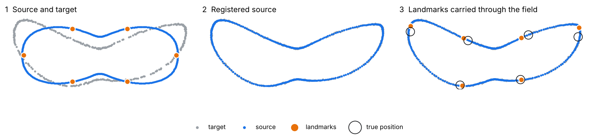

# torch-cpd

**A small, readable PyTorch implementation of non-rigid Coherent Point Drift that runs on CPU or GPU.**

[](https://github.com/gbravomorante/torch-cpd/actions/workflows/tests.yml)


`torch-cpd` deforms one point cloud onto another with the non-rigid Coherent Point Drift
algorithm ([Myronenko & Song, 2010](https://doi.org/10.1109/TPAMI.2010.46)), then lets you carry
*any* point through the fitted deformation. That second step is what makes it useful for moving
anatomical landmarks from an annotated template onto a new scan.



<sub>Reproduce with `python examples/landmark_transfer.py`. The six landmarks are not part of the
fit; they are moved through the deformation field afterwards. Mean error is 3% of the shape's
length. A single registration lets points slide slightly along an outline, which is why the
pipeline described below combines several templates.</sub>

## Why

Each CPD iteration builds an `N × M` distance matrix and solves a dense `M × M` linear system.
At 3,000 points per cloud that is nine million distances and a solve of roughly 2.7·10¹⁰
operations, repeated up to 150 times. This is ordinary GPU work, but the reference implementation
([pycpd](https://github.com/siavashk/pycpd)) is NumPy-only.

`torch-cpd` is a direct reimplementation of the algorithm, not a wrapper:

- **One code path for CPU and CUDA.** You can verify the two against each other, and the tests do.
- **Checked against pycpd**, so a fast answer is also the same answer.
- **Numerically careful in float32.** Distances use `torch.cdist`, not the `a² − 2ab + b²`
  expansion, which loses precision for scanner coordinates far from the origin.
- **Graceful device selection.** `device="auto"` uses the GPU only when the problem is large enough
  to be worth the transfer, and falls back to the CPU instead of failing when no GPU is available.

## Install

```bash
pip install "torch-cpd @ git+https://github.com/gbravomorante/torch-cpd"
```

PyTorch is a dependency. For GPU support, install the CUDA build of PyTorch first, following the
[official instructions](https://pytorch.org/get-started/locally/).

## Quick start

```python
import numpy as np
from torch_cpd import cpd_deformable, apply_deformation, describe_devices

print(describe_devices())  # which device will be used, in one line

template = np.loadtxt("template_points.txt")  # (M, 3) points sampled from the template surface
scan = np.loadtxt("scan_points.txt")  # (N, 3) points sampled from the new scan
landmarks = np.loadtxt("template_landmarks.txt")  # (K, 3) annotated on the template

result = cpd_deformable(template, scan, beta=0.15 * np.ptp(scan, axis=0).max(), alpha=1.0)
moved = apply_deformation(landmarks, result)  # (K, 3) landmarks on the new scan

print(result.device, result.iterations, result.converged)
```

`beta` sets the width of the smoothness kernel in the data's own units (larger means smoother,
more global deformations), and `alpha` sets the regularisation weight (larger means stiffer).
Scaling `beta` to the size of the object, rather than to the point spacing, keeps the results
consistent when the sampling density changes.

## Performance

These numbers were measured inside the landmarking pipeline below on an RTX 4080 SUPER, at its
default working size of 3,000 points per cloud:

| Deformable step | Time | Speed-up |
| --- | ---: | ---: |
| Previous CPU implementation | 118.7 s | 1× |
| `torch-cpd`, CPU | 50.6 s | 2.3× |
| `torch-cpd`, CUDA | **2.0 s** | **61×** |

At that rate, an estimated 300-specimen registration batch drops from about 46 hours to about
1.3 hours. Below about 400 points, transfer overhead cancels out the GPU's advantage, and
`device="auto"` stays on the CPU.

To reproduce on your own hardware:

```bash
python benchmarks/benchmark.py --sizes 500 1000 3000 --iterations 150
```

## Validation

```bash
pip install -e ".[dev]"
pytest
```

The tests check what matters for a scientific tool, not only that the code runs:

- **Agreement with pycpd** on the same problem, within 1% of the object's size. They are not
  bit-identical, because the convergence checks differ.
- **CPU and CUDA give the same answer**, when a GPU is present.
- **The deformation field is consistent.** Re-evaluating it at the fitted points reproduces the
  fitted cloud.
- **Basic behaviour holds.** Stiffer models fit less closely, identical clouds barely move, and bad
  inputs raise clear errors.

## In practice

`torch-cpd` is the deformable stage of an automated 3D landmarking pipeline for CT-derived and
surface-scanned bone. The pipeline combines segmentation, surface conditioning, multi-template
landmark transfer and an uncertainty-ranked review queue. Leave-one-out validation on 13 fully
annotated specimens (156 independent registrations against held-out, hand-placed landmarks)
gave these results:

- Multi-template consensus lowered mean landmark error by **49%** compared with a single-template
  rigid baseline.
- This PyTorch stage matched the reference implementation to about **one millionth of the
  object's size**.

The consensus method is being prepared for publication and is not part of this repository.

## Citing

If you use `torch-cpd` in published work, please cite the original algorithm, and this
repository if you wish (see [`CITATION.cff`](CITATION.cff)):

> Myronenko, A., & Song, X. (2010). Point Set Registration: Coherent Point Drift.
> *IEEE TPAMI*, 32(12), 2262–2275.

## License

[MIT](LICENSE) © Guillermo Bravo Morante · [gbravomorante.dev](https://gbravomorante.dev)
